# miniGames

Click the images below to play the game.

| | | |
|:---:|:---:|:---:|
| [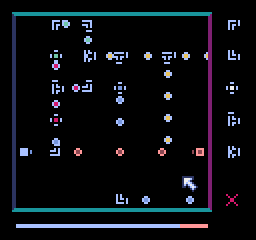](https://kitao.github.io/pyxel/wasm/launcher/?play=masatobu.miniGames.apps.pyxel_convert_send.dist.pyxel_convert_send_v2_0 "move to pyxel web launcher") [pyxel convert send](https://kitao.github.io/pyxel/wasm/launcher/?play=masatobu.miniGames.apps.pyxel_convert_send.dist.pyxel_convert_send_v2_0 "move to pyxel web launcher") |  [pyxel baseball](https://kitao.github.io/pyxel/wasm/launcher/?play=masatobu.miniGames.apps.pyxel_baseball.dist.pyxel_baseball_v1_0 "move to pyxel web launcher") |  [pyxel expand area](https://kitao.github.io/pyxel/wasm/launcher/?play=masatobu.miniGames.apps.pyxel_expand_area.dist.pyxel_expand_area_v1_0 "move to pyxel web launcher") |
|  [pyxel background worker](https://masatobu.github.io/miniGames/pyxel_background_worker/pyxel_background_worker_v1_0.html "move to github.io") |  [pyxel dig smith](https://kitao.github.io/pyxel/wasm/launcher/?play=masatobu.miniGames.apps.pyxel_dig_smith.dist.pyxel_dig_smith_v1_0 "move to pyxel web launcher") | [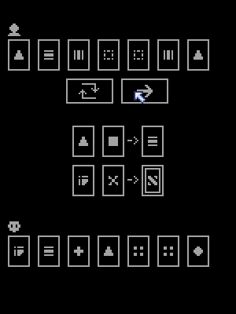](https://kitao.github.io/pyxel/wasm/launcher/?play=masatobu.miniGames.apps.pyxel_combo_card.dist.pyxel_combo_card_v1_0 "move to pyxel web launcher") [pyxel combo card](https://kitao.github.io/pyxel/wasm/launcher/?play=masatobu.miniGames.apps.pyxel_combo_card.dist.pyxel_combo_card_v1_0 "move to pyxel web launcher") |
| [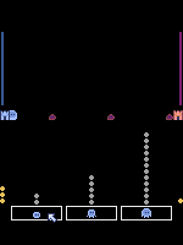](https://kitao.github.io/pyxel/wasm/launcher/?play=masatobu.miniGames.apps.pyxel_raise_units.dist.pyxel_raise_units_v1_0 "move to pyxel web launcher") [pyxel raise units](https://kitao.github.io/pyxel/wasm/launcher/?play=masatobu.miniGames.apps.pyxel_raise_units.dist.pyxel_raise_units_v1_0 "move to pyxel web launcher") | [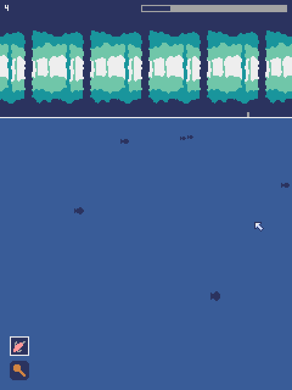](https://kitao.github.io/pyxel/wasm/launcher/?play=masatobu.miniGames.apps.pyxel_fishing.dist.pyxel_fishing_v1_0 "move to pyxel web launcher") [pyxel fishing](https://kitao.github.io/pyxel/wasm/launcher/?play=masatobu.miniGames.apps.pyxel_fishing.dist.pyxel_fishing_v1_0 "move to pyxel web launcher") | [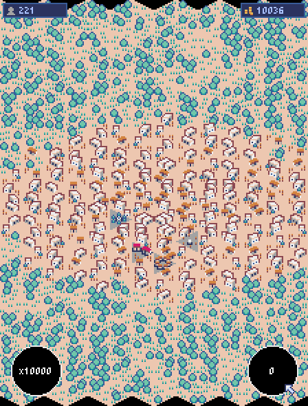](https://masatobu.github.io/miniGames/pyxel_reel_city/pyxel_reel_city_v1_1.html "move to github.io") [pyxel reel city](https://masatobu.github.io/miniGames/pyxel_reel_city/pyxel_reel_city_v1_1.html "move to github.io") |
| [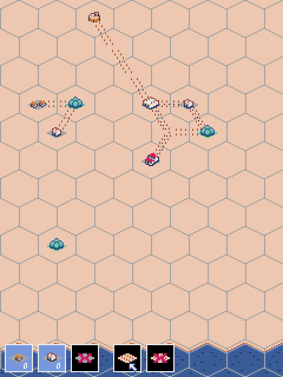](https://masatobu.github.io/miniGames/pyxel_connect_city/pyxel_connect_city_v1_0.html "move to github.io") [pyxel connect city](https://masatobu.github.io/miniGames/pyxel_connect_city/pyxel_connect_city_v1_0.html "move to github.io") | [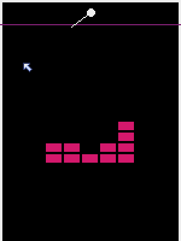](https://kitao.github.io/pyxel/wasm/launcher/?play=masatobu.miniGames.apps.pyxel_break_blocks.dist.pyxel_break_blocks_v1_0 "move to pyxel web launcher") [pyxel break blocks](https://kitao.github.io/pyxel/wasm/launcher/?play=masatobu.miniGames.apps.pyxel_break_blocks.dist.pyxel_break_blocks_v1_0 "move to pyxel web launcher") |  [pyxel sort water](https://kitao.github.io/pyxel/wasm/launcher/?play=masatobu.miniGames.apps.pyxel_sort_water.dist.pyxel_sort_water_v1_0 "move to pyxel web launcher") |
|  [pyxel drop hunt](https://kitao.github.io/pyxel/wasm/launcher/?play=masatobu.miniGames.apps.pyxel_drop_hunt.dist.pyxel_drop_hunt_v1_0 "move to pyxel web launcher") | [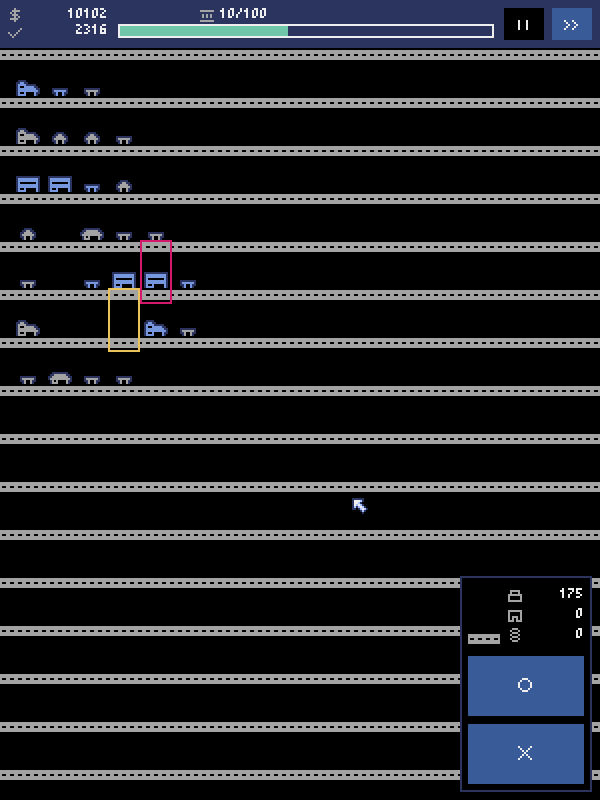](https://masatobu.github.io/miniGames/pyxel_shop_grow/pyxel_shop_grow_v1_0.html "move to github.io") [pyxel shop grow](https://masatobu.github.io/miniGames/pyxel_shop_grow/pyxel_shop_grow_v1_0.html "move to github.io") | [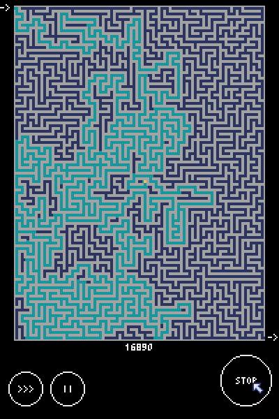](https://kitao.github.io/pyxel/wasm/launcher/?play=masatobu.miniGames.apps.pyxel_maze_guide.dist.pyxel_maze_guide_v1_0 "move to pyxel web launcher") [pyxel maze guide](https://kitao.github.io/pyxel/wasm/launcher/?play=masatobu.miniGames.apps.pyxel_maze_guide.dist.pyxel_maze_guide_v1_0 "move to pyxel web launcher") |
| [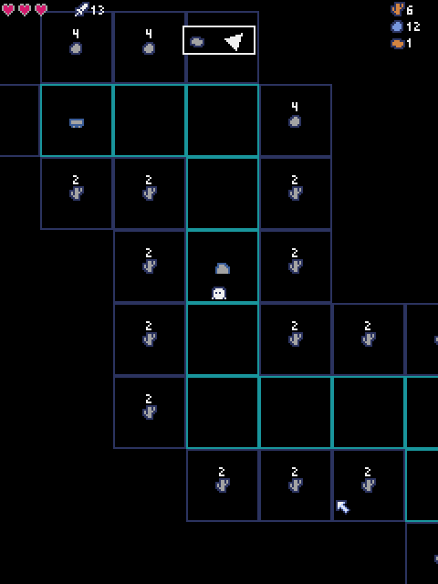](https://masatobu.github.io/miniGames/pyxel_tycoon/pyxel_tycoon_v1_0.html "move to github.io") [pyxel tycoon](https://masatobu.github.io/miniGames/pyxel_tycoon/pyxel_tycoon_v1_0.html "move to github.io") |  [pyxel poker](https://kitao.github.io/pyxel/wasm/launcher/?play=masatobu.miniGames.apps.pyxel_poker.dist.pyxel_poker_v1_1 "move to pyxel web launcher") | [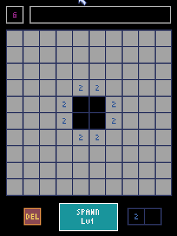](https://masatobu.github.io/miniGames/pyxel_merge/pyxel_merge_v1_0.html "move to github.io") [pyxel merge](https://masatobu.github.io/miniGames/pyxel_merge/pyxel_merge_v1_0.html "move to github.io") |
