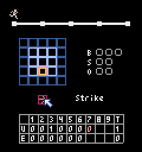
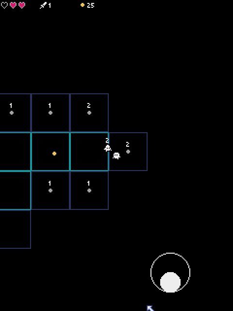
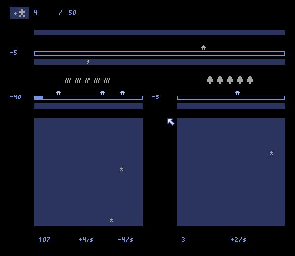
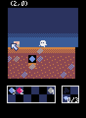
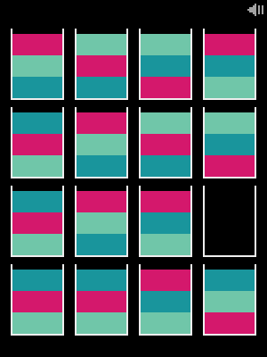
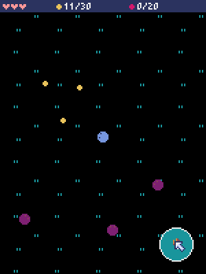
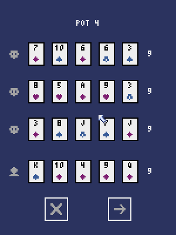

# miniGames

Click the images below to play the game.

<table>
<tr>
<td align="center"><a href="https://kitao.github.io/pyxel/wasm/launcher/?play=masatobu.miniGames.apps.pyxel_convert_send.dist.pyxel_convert_send_v2_0" title="move to pyxel web launcher"> pyxel convert send</a></td>
<td align="center"><a href="https://kitao.github.io/pyxel/wasm/launcher/?play=masatobu.miniGames.apps.pyxel_baseball.dist.pyxel_baseball_v1_0" title="move to pyxel web launcher"> pyxel baseball</a></td>
<td align="center"><a href="https://kitao.github.io/pyxel/wasm/launcher/?play=masatobu.miniGames.apps.pyxel_expand_area.dist.pyxel_expand_area_v1_0" title="move to pyxel web launcher"> pyxel expand area</a></td>
</tr>
<tr>
<td align="center"><a href="https://masatobu.github.io/miniGames/pyxel_background_worker/pyxel_background_worker_v1_0.html" title="move to github.io"> pyxel background worker</a></td>
<td align="center"><a href="https://kitao.github.io/pyxel/wasm/launcher/?play=masatobu.miniGames.apps.pyxel_dig_smith.dist.pyxel_dig_smith_v1_0" title="move to pyxel web launcher"> pyxel dig smith</a></td>
<td align="center"><a href="https://kitao.github.io/pyxel/wasm/launcher/?play=masatobu.miniGames.apps.pyxel_combo_card.dist.pyxel_combo_card_v1_0" title="move to pyxel web launcher"> pyxel combo card</a></td>
</tr>
<tr>
<td align="center"><a href="https://kitao.github.io/pyxel/wasm/launcher/?play=masatobu.miniGames.apps.pyxel_raise_units.dist.pyxel_raise_units_v1_0" title="move to pyxel web launcher"> pyxel raise units</a></td>
<td align="center"><a href="https://kitao.github.io/pyxel/wasm/launcher/?play=masatobu.miniGames.apps.pyxel_fishing.dist.pyxel_fishing_v1_0" title="move to pyxel web launcher"> pyxel fishing</a></td>
<td align="center"><a href="https://masatobu.github.io/miniGames/pyxel_reel_city/pyxel_reel_city_v1_1.html" title="move to github.io"> pyxel reel city</a></td>
</tr>
<tr>
<td align="center"><a href="https://masatobu.github.io/miniGames/pyxel_connect_city/pyxel_connect_city_v1_0.html" title="move to github.io"> pyxel connect city</a></td>
<td align="center"><a href="https://kitao.github.io/pyxel/wasm/launcher/?play=masatobu.miniGames.apps.pyxel_break_blocks.dist.pyxel_break_blocks_v1_0" title="move to pyxel web launcher"> pyxel break blocks</a></td>
<td align="center"><a href="https://kitao.github.io/pyxel/wasm/launcher/?play=masatobu.miniGames.apps.pyxel_sort_water.dist.pyxel_sort_water_v1_0" title="move to pyxel web launcher"> pyxel sort water</a></td>
</tr>
<tr>
<td align="center"><a href="https://kitao.github.io/pyxel/wasm/launcher/?play=masatobu.miniGames.apps.pyxel_drop_hunt.dist.pyxel_drop_hunt_v1_0" title="move to pyxel web launcher"> pyxel drop hunt</a></td>
<td align="center"><a href="https://masatobu.github.io/miniGames/pyxel_shop_grow/pyxel_shop_grow_v1_0.html" title="move to github.io"> pyxel shop grow</a></td>
<td align="center"><a href="https://kitao.github.io/pyxel/wasm/launcher/?play=masatobu.miniGames.apps.pyxel_maze_guide.dist.pyxel_maze_guide_v1_0" title="move to pyxel web launcher"> pyxel maze guide</a></td>
</tr>
<tr>
<td align="center"><a href="https://masatobu.github.io/miniGames/pyxel_tycoon/pyxel_tycoon_v1_0.html" title="move to github.io"> pyxel tycoon</a></td>
<td align="center"><a href="https://kitao.github.io/pyxel/wasm/launcher/?play=masatobu.miniGames.apps.pyxel_poker.dist.pyxel_poker_v1_1" title="move to pyxel web launcher"> pyxel poker</a></td>
<td align="center"><a href="https://masatobu.github.io/miniGames/pyxel_merge/pyxel_merge_v1_0.html" title="move to github.io"> pyxel merge</a></td>
</tr>
</table>
